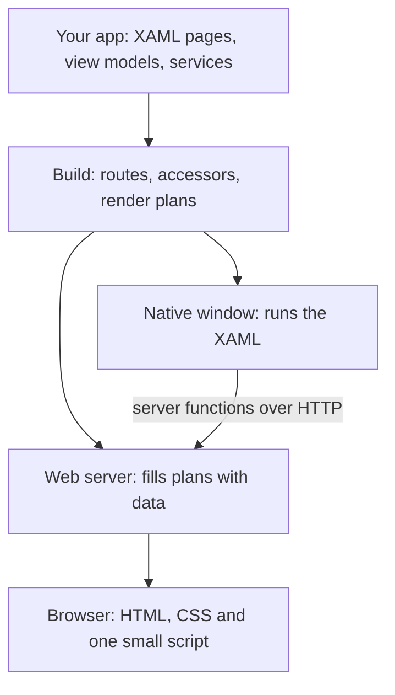
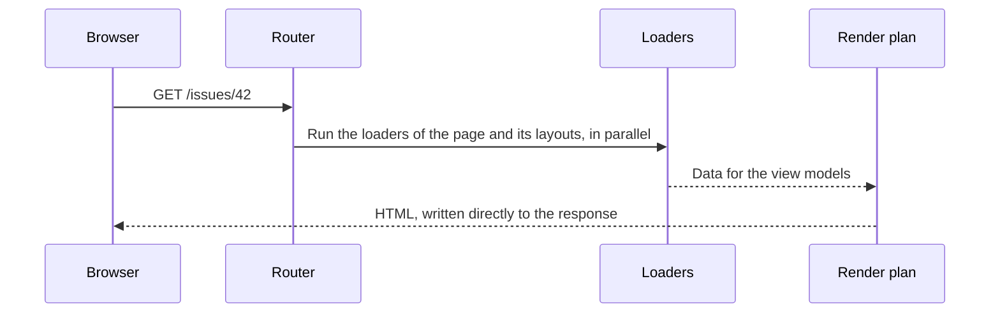
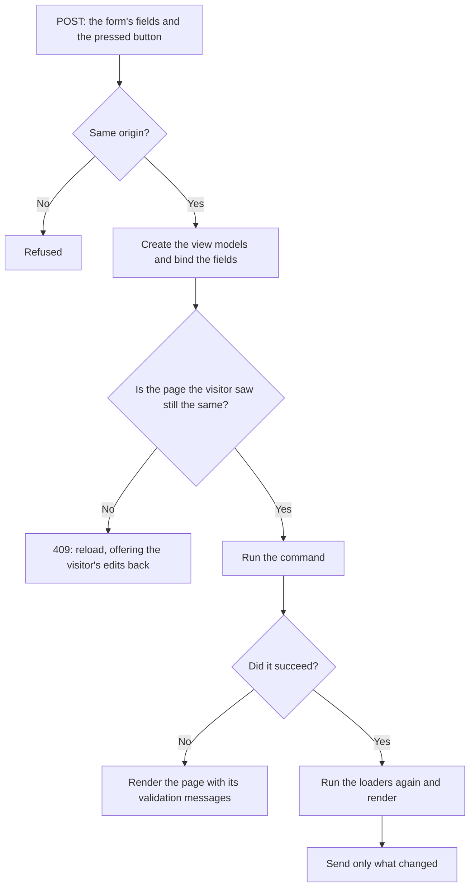

# Architecture

How Aioros is put together: what the pieces are, what happens when a page is requested, and why it is built this way. Read this if you want to work on the framework or judge its design. To build an app with it, start with [Concepts](concepts.md).

## Contents

- [The system at a glance](#the-system-at-a-glance)
- [How a page is answered](#how-a-page-is-answered)
- [How a post is answered](#how-a-post-is-answered)
- [Live pages and hot reload](#live-pages-and-hot-reload)
- [The desktop](#the-desktop)
- [Layout](#layout)
- [Rules](#rules)
- [Decisions](#decisions)
- [Security](#security)

## The system at a glance

An Aioros app is XAML pages and C# view models. On the web, the server turns each page into HTML and CSS. On the desktop, the same XAML runs natively.

Three parts do most of the work:

- **The page engine** runs Avalonia without a window. It lays a page out with its real styles and themes and writes the result as HTML. It compiles pages and answers the few requests a plan cannot.
- **Render plans** are what production serves. A plan is the page's fixed HTML with slots for the data. [Traced Render Compilation](trc.md) produces them.
- **The web target** is an ASP.NET Core host. It routes requests, runs loaders, fills plans and binds posts.

## How a page is answered

The route is found in a table generated at build time. The loaders run, the view models are created from their data, and the plan writes its bytes to the response through generated accessors. No control is created and no layout is computed, so production does not need Avalonia on this path.

A link click fetches the same page. The script swaps in what changed, so layouts stay in place and scroll and focus are kept.

If a plan is missing, the engine compiles the page on the first request and keeps the plan. Development always works this way, which is what makes hot reload simple. Production reads the plans that `aioros build` precompiled.

## How a post is answered

There is one interaction model, with no render modes to choose from. Every page is server-rendered HTML first, and every interaction is a post of an ordinary form.

The server keeps no state per visitor between requests. View models are created for each request. After a command succeeds, a view model with a `Receive` method keeps its instance and is handed the new data, and one without it is created again from that data.

Fields and buttons are named in the page, so a post can only name something the page wrote. A button that the page did not write is refused. Inside a list, each name carries the key of its item, and a mark at the end of each region says what the lists held. Together they stop a post from landing on a different item when a list has changed.

What a control keeps only in the browser, such as the step of a wizard, travels in a hidden field sealed with ASP.NET Core Data Protection. It is opened only under the name it was written for, so it cannot be forged or moved to another control.

The answer is usually a list of changed slots in JSON. When the plan cannot describe a change, the answer is an HTML fragment, and the script applies it by morphing the DOM.

## Live pages and hot reload

Both are streams of events over Server-Sent Events.

**Live pages** follow two sources: a view model's `PropertyChanged`, and the data keys invalidated in the app. An invalidation runs again only the loaders that read those keys.

**Hot reload** watches the project's XAML. A saved file drops the affected plans and the page refreshes in place. C# edits go through .NET Hot Reload. If an edit cannot be applied, `aioros dev` restarts the app and the page refreshes when it is back. Build errors appear in an overlay on the page.

Inside the process, components talk through an event bus built on `System.Threading.Channels`. There are no locks.

## The desktop

On the desktop there is no HTML. The target hosts the same XAML in a native Avalonia window and runs the same view models and loaders.

A service registered as a server function is called in process on the web. In an installed app the same interface is implemented by a generated HTTP client, and the database stays on the server. An installed app signs in through the system browser with PKCE.

## Layout

Aioros is one repository and one solution. Each concern is its own project, and the projects it may reference are fixed by its role.

| Project | Role |
| --- | --- |
| `src/Aioros.Abstractions` | Public contracts: composition, events, navigation, the UI tree |
| `src/Aioros.Routing` | Route templates, matching and route tables, with no UI and no host |
| `src/Aioros.Runtime` | Event bus, composition, render plans and their UTF-8 writer |
| `src/Aioros.Generators` | Source generators for accessors, routes and server functions, and the analyzers |
| `src/Aioros.CodeFixes` | The IDE's fixes for those diagnostics |
| `src/Adapters/Aioros.Avalonia` | The only engine project that references Avalonia: compiles pages to plans and binds posts |
| `src/Adapters/Aioros.ReactiveUI` | Optional support for ReactiveUI view models |
| `src/Targets/Aioros.Targets.Ssr` | The ASP.NET Core host and the browser's script |
| `src/Targets/Aioros.Targets.Desktop` | The native host |
| `src/Features/Aioros.Features.*` | Capabilities a target adds, such as `Live` and `HotReload` |
| `src/Aioros.Markup` | The `a:Web` hints, which reference only Avalonia so libraries can use them |
| `src/Platform/Aioros.Platform` | Settings that make any Avalonia app work well where it runs |
| `src/Aioros.Cli` | The `aioros` command |
| `src/Aioros.Testing` | Checks an app's or a library's tests can call |
| `src/Aioros` | The package an app installs |

A new project is assigned a role in `tests/Aioros.ArchitectureTests/Workspaces/ProjectMaps.cs`, or the architecture tests fail.

Inside a project, folders and namespaces name what the code does, never a technical layer.

## Rules

`tests/Aioros.ArchitectureTests` reads every project with Roslyn and enforces the structure:

- Every project has a role, and references only what its role allows.
- Avalonia appears only in the adapter, the native target, the platform profile and the markup package.
- ASP.NET Core appears only in web targets and tools.
- Every class is `sealed` or `static`.
- There are no locks and no reflection on the request path.
- There are no comments, except XML documentation on the public API.
- No type is longer than 600 lines.
- Every acceptance criterion has exactly one test.

Each rule runs against the framework, a compliant fixture and a fixture that breaks it on purpose, so a rule cannot pass by finding nothing. The compiler adds banned APIs for anything that blocks a thread, the threading analyzers, and the trim and Native AOT analyzers on the production path, all as errors.

## Decisions

The choices that shape the system, and the reasons for them.

**HTML from the server, not WebAssembly.** Running Avalonia in the browser through WebAssembly was measured at 4.95 MB and 6.6 seconds to interactive on 4G for the first visit, with no accessible nodes and the page freezing during heavy work. HTML from the server avoids all of that and works with search engines and screen readers. What needs more than a server can drive runs in the native app.

**Compile the page, do not re-render it.** Rendering XAML per request would be far too slow, and building a parallel set of web components would mean maintaining every control twice. Tracing the real render gives the speed of a compiled template and the fidelity of the real framework. See [Traced Render Compilation](trc.md).

**Real controls where the web has them.** A `TextBox` is an `<input>`, a `ComboBox` is a `<select>`, an `Expander` is a `
`. The browser then provides focus, accessibility and form behavior for free. Only what the web lacks is drawn.

**Server-driven interactivity.** Commands run on the server and answers apply in place, the model of Phoenix LiveView, over plain HTTP. There is one small generic script, written once, and an app ships no JavaScript of its own. Pages keep working without it, as plain forms and links.

**Loaders outside the view model.** Data loading follows Remix and React Router. It keeps view models plain, lets the loaders of a page and its layouts run in parallel, and works the same on the desktop.

**File-based routes.** Routes follow the Next.js App Router, so a route needs no registration and a developer coming from the web already knows them.

**Stateless by default.** A request carries what it needs, so a server can restart or scale out without losing visitors. The exception is explicit: a live page holds a connection.

**Streaming, never locks.** Each piece of state has one owner, and readers get immutable snapshots. This keeps the request path free of contention and rules out a class of deadlocks.

**Specialize at build time.** Source generators resolve routes, accessors and server functions, so production needs no reflection and can run under Native AOT.

**A thin layer over Avalonia.** An ordinary MVVM app should port mostly unchanged, and Aioros appears in the XAML and in the composition rather than in view models. Avalonia is today's engine, kept behind one adapter, so the framework is not tied to it.

**A clear guarantee.** What is guaranteed on the web is the base controls under the Fluent theme, Aioros.Cosmo and Aioros.Pictor, each checked by a test that walks every value an input can take. Third-party themes and libraries work on a best-effort basis, and the build reports what it cannot prove.

## Security

Aioros runs on ASP.NET Core and uses its authentication, authorization and Data Protection. On top of that, it adds the following:

- **Cross-site posts are refused** through `Sec-Fetch-Site` and `Origin`, the approach of Go's `CrossOriginProtection`.
- **Every document has a Content Security Policy** outside development. Scripts come from the app's origin only.
- **Links are limited to safe schemes.** A bound address can be relative, `http`, `https`, `mailto` or `tel`.
- **Values are escaped** by every slot of a plan.
- **Posted state is sealed**, and a posted button must be one the page wrote.
- **Private answers are not cached.** A page is cached only when every loader declares it public and it has no access rules.

To report a vulnerability, see the [security policy](../SECURITY.md).
