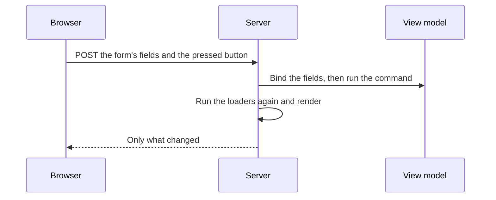

# Concepts

The handful of ideas you need to build an app with Aioros. It assumes you know some XAML and C#, and it does not assume you know the web.

## Contents

- [Pages and routes](#pages-and-routes)
- [Layouts](#layouts)
- [View models](#view-models)
- [Loaders](#loaders)
- [Commands and fields](#commands-and-fields)
- [Lists](#lists)
- [Navigation](#navigation)
- [Styles and themes](#styles-and-themes)
- [Hints for the web](#hints-for-the-web)
- [Services and server functions](#services-and-server-functions)
- [Live pages](#live-pages)
- [The desktop](#the-desktop)
- [What the build checks](#what-the-build-checks)

## Pages and routes

A page is a `Page.axaml` file, and its folder under `Pages` is its route. The rules follow the Next.js App Router:

| Path | Route |
| --- | --- |
| `Pages/Page.axaml` | `/` |
| `Pages/about/Page.axaml` | `/about` |
| `Pages/issues/[id]/Page.axaml` | `/issues/{id}` |
| `Pages/docs/[...path]/Page.axaml` | `/docs/{*path}` |
| `Pages/(marketing)/pricing/Page.axaml` | `/pricing`; a `(group)` folder does not change the URL |
| `Pages/_shared/Card.axaml` | No route; a `_private` folder is never routed |

`Pages/NotFound.axaml` is shown for a route that does not exist, and `Pages/Error.axaml` for an unhandled error.

A page sets its title and description in XAML with `a:Page.Title` and `a:Page.Description`. A layout can set `a:Page.TitleTemplate`, such as `%s · My App`.

## Layouts

A `Layout.axaml` wraps every page in its folder and below it. It says where the page goes with `<a:Outlet />`:

```xml
<UserControl xmlns="https://github.com/avaloniaui" xmlns:a="https://aioros.dev"
             a:Page.Title="MyApp" a:Page.TitleTemplate="%s · MyApp">
  <StackPanel>
    <Border Padding="24,14">
      <Border a:Web.Href="/about"><TextBlock Text="About" /></Border>
    </Border>
    <Border Padding="32" MaxWidth="900">
      <a:Outlet />
    </Border>
  </StackPanel>
</UserControl>
```

Layouts nest. Moving between two pages that share a layout replaces only what changed.

## View models

A page names its view model with `x:DataType`. A source generator builds it, with its services from dependency injection. The view model is ordinary MVVM and has no web code in it, which is what lets the same class run on the desktop.

## Loaders

When a page needs data, add a loader beside it: `Page.Loader.cs` next to `Page.axaml`. A loader is a class whose services come through its constructor. Its route parameters arrive as arguments:

```csharp
using Aioros.Pages;

public sealed class IssueLoader(IIssueFunctions issues)
{
    public async Task<LoaderResult<IssueData>> LoadAsync(string id) =>
        await issues.FindAsync(id) is { } issue
            ? LoaderResult.With(new IssueData(issue), issue.Title)
            : LoaderResult.NotFound();
}
```

The view model takes the loader's data in its constructor:

```csharp
public sealed partial class IssueViewModel(IssueData data, IIssueFunctions issues) : ObservableObject
{
    // ...
}
```

A loader can also answer with `LoaderResult.Redirect("/login")`. The loaders of a page and its layouts run in parallel. Marking a loader `[Cached(60)]` declares that its data is the same for every visitor for 60 seconds, so the page can be served from the cache.

## Commands and fields

On the web, a button with a `Command` is a real form submission. The framework's small script sends it with `fetch` and applies the answer in place, keeping the scroll and the focus. Without the script, the page still works as a plain form.



A few things follow from this model:

- **Each request gets a fresh view model.** After a command succeeds, the loaders run again and the page is rendered from the new data. State that is neither a posted field nor loader data does not survive. To keep it, add a public `void Receive(TData data)` to the view model: it is then kept across the command and receives the new data. State that should be shareable can live in the URL instead.
- **Two-way fields travel with the next post.** A `TextBox` bound two way sends its value when a button is pressed. A selection bound two way, such as a `ComboBox`, a `ListBox` or a `TabControl`, posts as soon as it changes. To post a text box as the user types, set `Delay` on its binding, or `a:Web.Delay` to do that only on the web.
- **Validation is `INotifyDataErrorInfo`.** A command that leaves errors on the model is treated as failed: the loaders do not run again, and the fields show their messages.
- **A command navigates through `INavigator`.** See [Navigation](#navigation).

## Lists

Bind an `ItemsControl`, `ListBox`, `TabControl` or data grid to a collection as usual. Fields and buttons inside a list item are tied to that item by a key: `a:Web.ItemKey` on the list if you set one, otherwise the item's `Id`, otherwise the item itself when it is a text or a number.

If the list changed since the page was written, for example because someone else deleted a row, the post is refused instead of acting on the wrong item. The page reloads and offers back what the visitor typed.

Items without any identity can only be counted. The build warns about those lists, and setting `a:Web.ItemKey` fixes it.

## Navigation

Links are written with `HyperlinkButton` and its `NavigateUri`, or with `a:Web.Href` on any control. The script fetches the new page and swaps in what changed. A link written with `a:Web.Href` is marked when it points to the current page, so a `:current` style can highlight it.

From a view model, take `INavigator` through the constructor:

```csharp
await navigator.GoToAsync("/issues");
```

## Styles and themes

Styles are Avalonia styles: selectors, classes, control themes, `:pointerover`, transitions and animations. You write them once in XAML, and the framework writes the equivalent CSS for the web.

```xml
<Style Selector="Border.nav:pointerover">
  <Setter Property="Background" Value="#14808080" />
</Style>
```

Light and dark themes come from your theme's resources. A link to `/theme/toggle` switches them. The setting `Aioros:Theme` chooses the default: `light`, `dark` or `system`.

For a full design system, [Aioros.Cosmo](https://github.com/singularengine/aioros-cosmo) provides components and themes, and [Aioros.Pictor](https://github.com/singularengine/aioros-pictor) provides charts.

## Hints for the web

The XAML namespace `https://aioros.dev` adds hints that apply on the web and are ignored on the desktop. These are the ones you will use first:

| Hint | What it does |
| --- | --- |
| `a:Web.Href` | Makes any control a link |
| `a:Web.StackBelow` | Stacks a grid's columns below a width in pixels |
| `a:Web.HideBelow`, `a:Web.HideAbove` | Hides a control by viewport width |
| `a:Web.Delay` | Posts a text box a moment after the user stops typing |
| `a:Web.Live` | Keeps the page up to date as data changes |
| `a:Web.ItemKey` | Names what identifies a list's items |

When the behavior must differ by platform, `OnPlatform` accepts a `Web` value.

## Services and server functions

Services are registered on `builder.Services`, as in any ASP.NET Core app. A page's view models live in one scope per request on the web and one per page on the desktop.

A service that must always run on the server, because it touches the database or holds a secret, is declared as a server function:

```csharp
builder.AddServerFunction<IIssueFunctions, IssueFunctions>();
```

On the web it is called in process. In an installed desktop app, the same interface is implemented by a generated HTTP client, so the view models do not change.

## Live pages

Set `a:Web.Live="True"` on a page, and the server pushes changes over Server-Sent Events as its data changes. Only the loaders that read the changed data run again, and only what changed is sent.

## The desktop

`dotnet run -- --desktop` opens the same app in a native window. The XAML runs natively, with no browser and no translation, and the pages, view models and services are the ones the web uses.

Where the right behavior depends on the platform and on your app, such as a real file path or a very large file, the framework does not guess. It gives you `OnPlatform` to branch.

## What the build checks

The compiler catches what would otherwise show up in production. Each diagnostic has an `AIOROS` code, and the message says what to change. For example:

| Diagnostic | What it reports |
| --- | --- |
| `AIOROS010` | A page that cannot become a render plan, with the reason and the XAML element |
| `AIOROS012` | A page view model registered as a singleton, which would be shared between users |
| `AIOROS013` | Static mutable state in a view model |
| `AIOROS014` | A process-wide messenger or service locator |
| `AIOROS024` | `[Cached]` on a loader that reads the user or the cookies |
| `AIOROS033` | A list with fields in its items and no identity |

For how all of this works underneath, read the [architecture](architecture.md).
