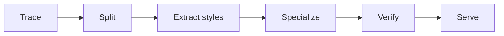

# Traced Render Compilation

Traced Render Compilation is how Aioros turns a XAML page into HTML that a server can fill in microseconds. This document explains the steps and what they cost. For how it fits into the rest of the system, see the [architecture](architecture.md).

## The idea

The page is rendered once by the real XAML framework. Aioros records which parts of the output are fixed and which come from data, and compiles that recording into a render plan: HTML that is already written, with holes for the data. Each request only fills the holes.

No single step is new. What is different is the source: the template is not written for the web, it is traced from a desktop framework's real render, and each compiled page is checked against that render.

## The steps

### Trace

The page is realized by Avalonia on its own thread, with its view model and, where a list is empty, a stand-in item. Avalonia applies the styles, themes, templates and layout exactly as on the desktop. A recorder then walks the visual tree and writes HTML. Wherever a value comes from a binding, it records a slot instead of the value.

### Split

Whatever does not depend on data becomes literal text, encoded once as UTF-8. Whatever does becomes a node in the plan: a value, a condition, a repeated item template, a choice between variants, a tree or a nested view. This is partial evaluation: what is known at build time is computed once.

### Extract the styles

The CSS comes from the values Avalonia resolved, not from translating XAML selectors. Each distinct set of declarations becomes one class, named by its hash and written once. A theme's states become `:hover`, `:active`, `:focus-visible` and `:disabled` rules. Panels become CSS grid or flexbox. The style sheet is an external file, one per theme, that browsers can cache.

### Specialize

A source generator emits typed getters and setters for every member the bindings read. Production therefore reads data without reflection and without starting Avalonia.

### Verify

`aioros build` renders each page through its plan and through Avalonia, and fails on a single byte of difference. A page that cannot be planned fails the build too, with the reason and the XAML element responsible. In development, the engine answers such a page so you can keep working, and the log says why.

### Serve

A request runs the page's loaders, walks the plan and fills each slot through a generated accessor, writing to the response through pooled buffers. No control is created and no layout is computed, and plans run under Native AOT.

## The page's own state

An input that nothing binds, such as a free-standing check box, holds its value in the request itself rather than in a model. A post writes that value and the answer reads it, in the way React's uncontrolled inputs keep their value outside the component's state.

The plan can only do this safely where no app code could observe the input. Under a guaranteed theme, and with no outside style that changes with the input's state, a test for each input type walks every value it can take and compares the plan's render with Avalonia's. Any other input is marked as outside the guarantee and proven per page at build time. Until it is proven, the engine answers that page's posts.

## Where the ideas come from

| Step | Technique | Seen in |
| --- | --- | --- |
| Compile, then serve | Ahead-of-time templates | Svelte, Razor, Askama, templ |
| Split | Static parts and holes | Lit, Solid, Marko, Next.js Partial Prerendering |
| Trace | Specializing by recording one execution | Tracing JIT compilers such as LuaJIT |
| Extract styles | Zero-runtime CSS, deduplicated classes | vanilla-extract, Linaria, atomic CSS |
| Specialize | Generated accessors instead of reflection | EF Core's compiled model, ASP.NET Core's Request Delegate Generator |
| Verify | A reference implementation as the oracle | Reftests in the Web Platform Tests |

## What it costs

- The trace sees one render. Output that depends on data it did not see must be enumerable, as one variant per value or one template per type, or the page is reported.
- The generated CSS does not look like the XAML, because its classes are hashes. The XAML is what you read and debug.
- The build runs Avalonia, so `aioros build` needs Avalonia's native libraries. Production does not.
